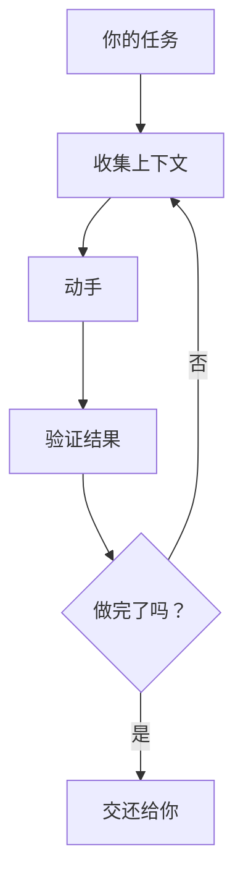

## Q
**Coding agent · loop、tools、context**｜摘要 · 必会

你对 coding agent 说"修好失败的测试"。它在内部怎么一步步做完？它凭什么敢说"修好了"？

## A
**三个阶段，反复循环：** gather context（收集上下文）→ take action（动手）→ verify results（验证结果）。每次用 tool，结果都回到 context，决定下一步。

"修好失败的测试"可能是这样跑的：跑测试 → 读报错 → 搜相关源文件 → 读文件 → 改 → 再跑测试。

**tools 的五类（Claude Code）：** 文件操作、搜索、执行（shell、git、测试）、Web、code intelligence（类型错误、跳转定义，需插件）。

**harness：** 模型只负责思考；包在外面提供 tools、管理 context、执行权限的那层程序叫 harness（agentic harness）。同一个模型，换 harness，表现可以差很多。

**能力从哪来：** 来自**环境反馈**（测试输出、报错、截图），不是来自一次写对。没有反馈的循环，就是模型自说自话。

**出处：** Claude Code docs《How Claude Code works》（The agentic loop；Tools）
