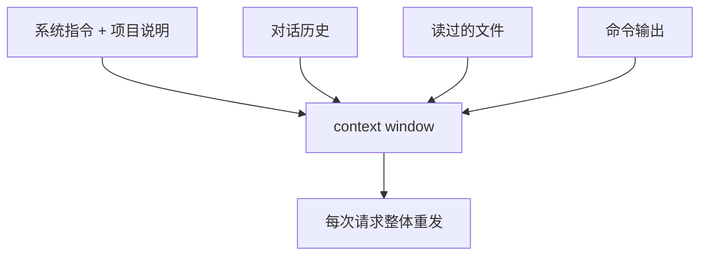

## Q
**Context window · 什么占位置**｜摘要 · 必会

一个 agent session 跑了两小时，表现明显变差。context window 里装的都是什么？为什么越满越差？

## A
**占位置的东西：** 对话历史、读进来的文件内容、命令输出、CLAUDE.md（项目说明文件，t03 讲）、自动记忆、系统指令、已加载的技能。你每让它读一次文件、跑一次长日志，都在占。

**为什么越满越差：** 每次请求都把整个 context 重新发给模型，早期的指令离当前越远越容易被忽略，噪声（无关的旧日志、失败的尝试）越多越干扰判断。

**接近上限时：** Claude Code 会自动 compaction（把历史压缩成摘要）。摘要保留你的请求和关键代码片段，但**早期的详细指令可能丢失**，所以必须长期有效的规则要写进项目说明文件，不要只说一遍。`/context` 可以看谁在占空间。

出处

Claude Code docs《How Claude Code works》（The context window；When context fills up）

