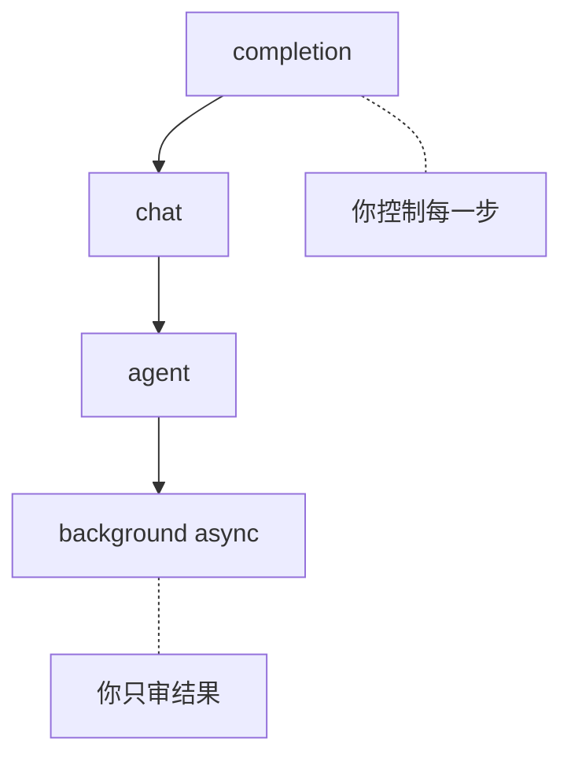

## Q
**编程助手的四种形态**｜摘要 · 必会

completion、chat、agent、background async 四种形态，差别在哪？从补全到 agent，你交出去的到底是什么？

## A
| 形态 | 上下文从哪来 | 谁在动手 | 适合 |
|---|---|---|---|
| **completion** | 光标附近的代码 | 你写，它续 | 样板、一行到几行 |
| **chat** | 你贴进去或选中的内容 | 你复制结果 | 解释、问方案、小片段 |
| **agent** | 它自己读仓库、跑命令 | 它改文件、跑测试 | 跨文件的明确任务 |
| **background async** | 同 agent，但在云端隔离环境里跑 | 它独立做完，交回分支或 PR | 可以离开去做别的事的任务 |

**权责的转移：** 越往右，你越少看到过程，越依赖**事后验证**。completion 错了你当场看见；background async 错了，你是在 diff 里才发现。所以越自主的形态，越需要提前给它"做完"的判据（见 t02 的 check）。

**时效标注（2026-11 官方文档）：** Claude Code 可在本机、云端 VM、或浏览器远程控制本机三种环境运行；Cursor 的 cloud agents 在隔离 VM 里工作、推到单独分支；Codex cloud 每个任务一个独立工作区，结果可提交或开 PR。产品名和入口会变，形态不变。

**出处：** Claude Code docs《How Claude Code works》（Execution environments）；Cursor docs《Cloud Agents》（background-agent）；OpenAI Codex docs《Cloud》
