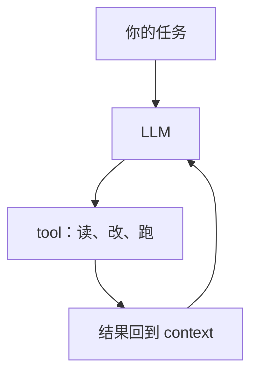

## Q
**LLM · 五个词**｜先修 · 必会

后面每张卡都会用到这五个词：LLM、token、context window、coding agent、prompt injection。各是什么？

## A
| 词 | 一句话 |
|---|---|
| **LLM**（large language model） | 读一段文本，预测接下来最可能的文本，一次一小块；写代码、解释代码都是在"续写" |
| **token** | LLM 处理文本的最小单位，可能是一个词、词的一部分或一个符号；用量、费用、长度上限都按 token 算 |
| **context window** | 一次请求里模型能"看到"的全部内容的上限（以 token 计）：你的提示、对话历史、读进来的文件、命令输出、它自己的回复都占位置 |
| **coding agent** | 在 LLM 外面套一层程序：模型可以调用 tool（读文件、改文件、跑命令），看到结果后再决定下一步，直到任务完成 |
| **prompt injection** | 攻击者把恶意指令写进模型会读到的文本里（网页、README、issue），让模型把它当成你的命令去执行 |

**两个常用词：** **prompt**＝你发给模型的那段输入；**session**＝一次连续的对话，有自己的 context window，新开一个 session 就是一张白纸。

出处

Claude Code docs《How Claude Code works》（The agentic loop；The context window）；Claude Code docs《Security》（Protect against prompt injection）

