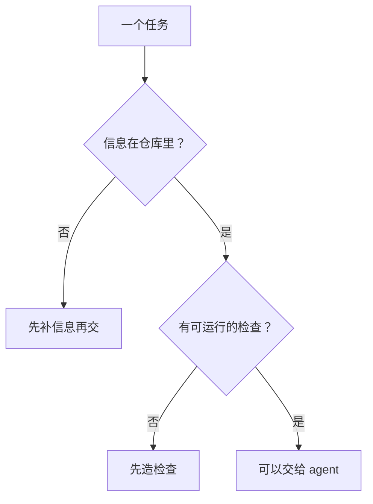

## Q
**模型的能力边界**｜摘要 · 必会

同事问："这件事交给 agent 能行吗？"你用什么标准判断？

## A
| 通常行 | 通常不行 |
|---|---|
| 样板代码、测试骨架 | 代码里读不出来的**隐含约束**（会议上定的规矩、只有某人知道的部署流程） |
| 迁移：框架升级、API 替换 | **跨系统一致性**：改了这边，另一个服务的假设也变了 |
| 解释一段代码 | **没有验证手段**的任务：没有测试、没法运行 |
| 范围明确的改动 | 范围含糊、"让它自己看着办"的需求 |

**一条标准：** 这件事有没有一个我能运行的、通过/失败分明的检查？有，大概率能交；没有，先造检查，或者你自己做。

**为什么"读不出来"是硬边界：** agent 擅长读仓库，所以代码里有的它基本都能找到；它缺的是**从没写进仓库的信息**。官方建议只往项目说明文件里写这类信息。

出处

Claude Code docs《Best practices》（Tell Claude what it can't see；Give Claude a check to run）

