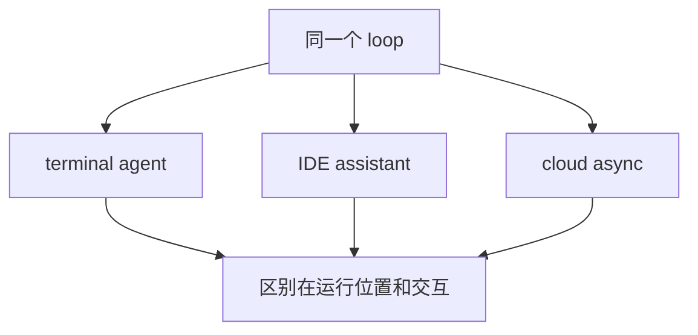

## Q
**工具对照 · 三种类型**｜摘要 · 追问

Claude Code、Codex、Cursor、Copilot 经常被放在一起比。比的时候该按什么维度分，而不是按品牌？

## A
| 类型 | 运行位置 | 你看到什么 | 典型场景 |
|---|---|---|---|
| **terminal agent** | 你的终端，直接访问本机项目和命令 | 对话流、命令输出 | 跨文件改动，脚本化与 CI |
| **IDE assistant** | 编辑器里 | 行内补全、侧栏对话、diff | 边写边问，小范围改 |
| **cloud async agent** | 云端隔离环境 | 任务列表，最后是分支或 PR | 并行许多任务、不占本机 |

**核心判断：** 底下是同一种 agent loop；差别是**在哪运行、你怎么介入、结果怎么交回**。多数产品现在同时提供多种形态（2026-11：Claude Code 有终端、桌面、IDE 扩展、网页、Slack、CI 入口；Cursor 有桌面 agent 与 cloud agents；Codex 有 CLI 与 cloud），所以别记品牌的"定位"，记形态的取舍。

出处

Claude Code docs《How Claude Code works》（Interfaces）；Cursor docs《Cloud Agents》；OpenAI Codex docs《Cloud》

