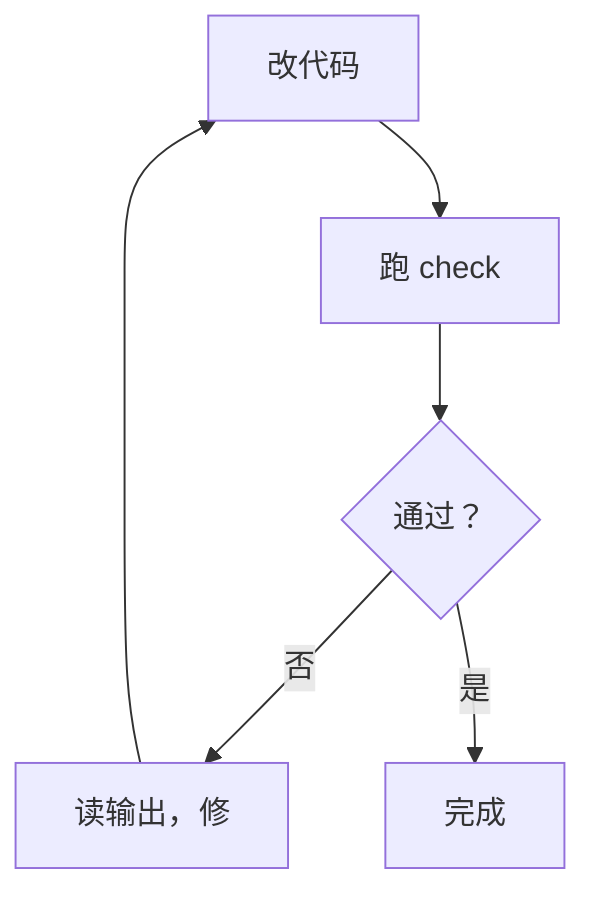

## Q
**可运行的 check · 最高杠杆**｜摘要 · 必会

只允许你改进一件事让 agent 更可靠，选什么？为什么？

## A
**选：给它一个能运行、结果非通过即失败的 check。**

官方文档的原话意思：agent 在工作"看起来完成"时停下；如果没有东西告诉它是否真的完成，你就成了测试套件，每个错误都躺在那里，直到你碰巧发现。

**check 的形式：** 测试文件、构建的退出码、type check（类型检查）、lint（风格与静态检查）、把输出和 fixture 对比的脚本、浏览器截图对照设计稿。

**严格程度从低到高：**
1. 在 prompt 里写"改完跑 auth 测试，通过为止"——它自己决定何时满意；
2. 目标条件（goal）：另一个模型每轮检查是否达成；
3. Stop hook（hook＝harness 在固定时点执行的脚本；Stop 是 agent 想结束这一轮时触发）：脚本以退出码 2 返回，agent 被送回去继续；
4. 由没写这段代码的人或 session 来审。

**一句话进项目说明文件（CLAUDE.md（每次会话自动加载的项目说明），t03 讲）：** 跑测试、type check、lint 的确切命令。

**出处：** Claude Code docs《Best practices》（Give Claude a check to run）
