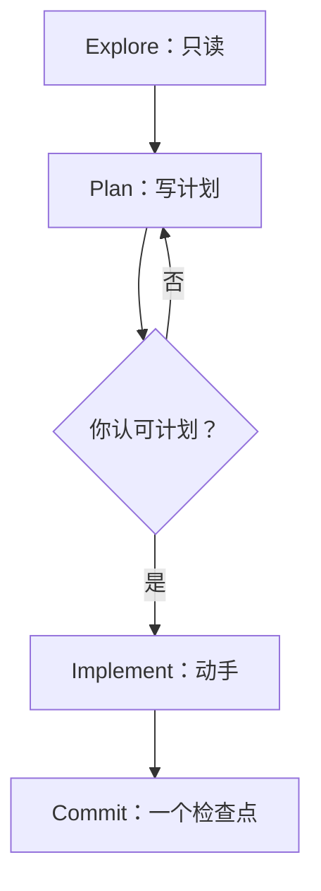

## Q
**Explore → plan → implement → commit**｜摘要 · 必会

你要给一个陌生的服务加限流。为什么不直接说"加上限流"，而是分四段走？每段 agent 允许做什么？

## A

| 阶段 | 允许 | 你得到什么 |
|---|---|---|
| **Explore** | 只读：读文件、搜索、问问题 | 它对代码的理解，你能纠正误解 |
| **Plan** | 提出要改哪些文件、怎么验证，不改代码 | 一份你能审的计划 |
| **Implement** | 按计划改、跑检查 | 一个有范围的 diff |
| **Commit** | 提交 | 可回退的检查点 |

**为什么先读后写：** 动手之后才发现方向错，要撤的是一堆已经写好的代码；计划阶段发现方向错，只需要改一段文字。

**工具里的对应（2026-11）：** Claude Code 有 Plan 权限模式（Shift+Tab 切换）：Claude 探索并提出计划，但不改源文件。官方的说法是 Plan 模式下只探索、提计划。

**什么时候可以跳过：** 改动小到你能一句话描述 diff（改个文案、重命名一个变量）。跳过的代价是方向错了你要在 diff 里才发现。

**出处：** Claude Code docs《How Claude Code works》（Control what Claude can do：Plan mode）
