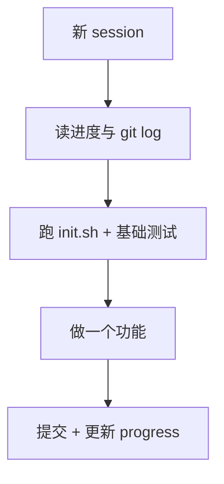

## Q
**长任务 · 用文件接力**｜摘要 · 必会

一个要跑几十个 session 的长任务，每个新 session 都是一张白纸。怎么让后一个 session 接得上前一个？

## A
**问题（Anthropic 工程博客）：** agent 一次做太多、context 用完时功能写到一半、没有记录；后来的 session 有时看到已有进展，就宣布项目完成。

**解法：用文件保存状态，而不是靠对话。**

| 文件 | 作用 |
|---|---|
| `init.sh` | 启动开发服务的脚本，每个 session 开头跑 |
| progress file（如 `claude-progress.txt`） | 日志：之前的 session 做了什么 |
| feature list（JSON） | 每个功能一条，含测试步骤和 `passes` 字段，agent 只许改 `passes` |
| git 提交 | 每个功能一个干净、可合并的提交 |

**每个新 session 的开头：** 看工作目录、读 git log 和 progress file、读 feature list、跑 `init.sh`、跑一遍基础端到端测试，**先发现上一个 session 留下的 bug**，再做新功能。

**为什么 feature list 用 JSON：** 博客说模型不太会不恰当地改写 JSON，不像 Markdown。

出处

Anthropic Engineering《Effective harnesses for long-running agents》

