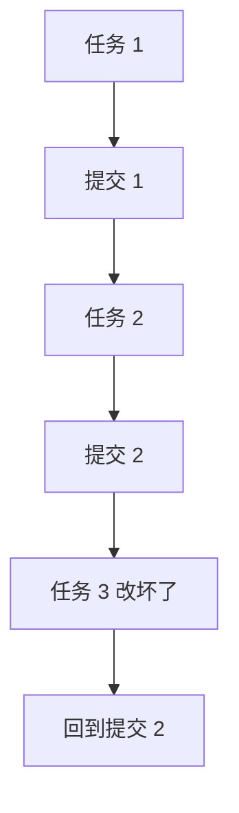

## Q
**Small commits · 版本控制当撤销键**｜摘要 · 必会

agent 在一个 session 里改了 25 个文件，你只想要其中一半。为什么说"每个任务一个提交"是和 agent 合作的基本功？

## A
**一个任务一个提交：**
- 每个提交是一个可以单独回退、单独审查的块；
- agent 改坏了，`git revert` 或 `git reset` 回到上一个好状态；
- 大改拆成小块，每块 diff 人能读完。

**为什么不能只靠工具自己的撤销：** Claude Code 的 checkpoint（编辑前自动存的文件快照）只覆盖它用自己的文件工具编辑的文件，只被 Bash 命令改动的文件不会还原，远程系统的动作（数据库、API、部署）也不能撤。官方说它和 git 是并用关系，不是替代。

**做：** 开始前工作区干净；每完成一个可验证的小目标就提交；让 agent 提交时写清楚改了什么。

**出处：** Claude Code docs《Best practices》（Steer the session：Checkpoints）；《How Claude Code works》（Undo changes with checkpoints）
