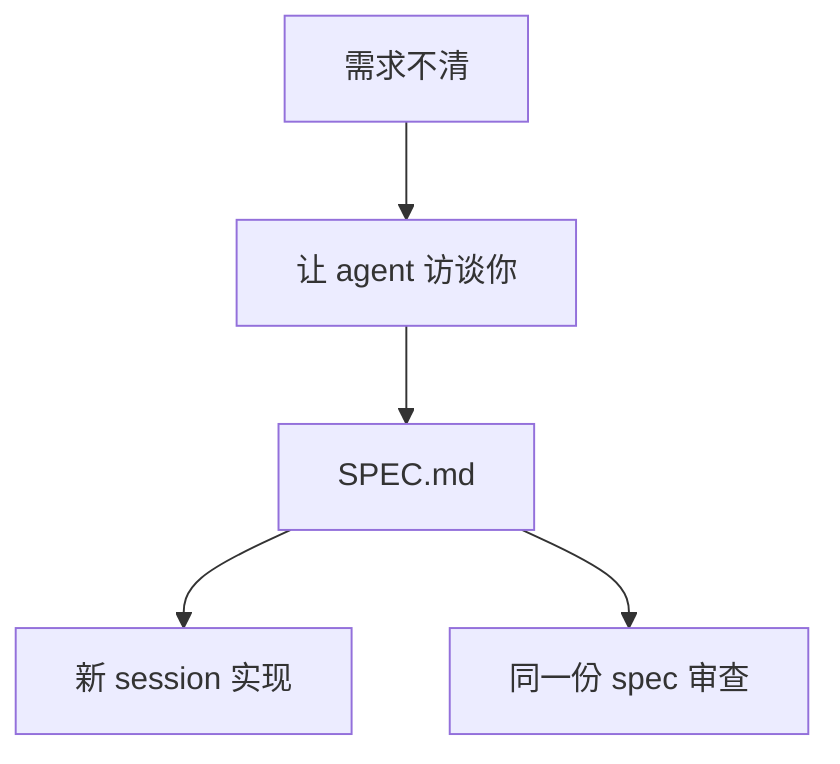

## Q
**Spec-first · 规格就是评测**｜摘要 · 必会

spec-first（spec-driven development）里，一份 spec 要写什么？为什么说"规格就是评测"？

## A
**spec**＝实现之前写下的需求文档；给 agent 的 spec 要让它**自己能判断做没做完**。

| 部分 | 写什么 | 例（限流） |
|---|---|---|
| 目标 | 一句话 | 公开 API 按 key 限流 |
| acceptance criteria（验收标准） | 可检验的条件 | 超限返回 429，带 Retry-After |
| 边界条件 | 容易漏的情况 | 并发请求、时钟漂移、key 缺失 |
| 范围外 | 明确不做 | 不做按用户的配额 |

**规格就是评测：** 同一份 spec 既是实现的目标，又是审查的标尺（"逐条对照 SPEC.md，看每个需求是否实现、列出的边界是否有测试"）。没有 spec，审查只能靠感觉。

**做：** 需求没想清时先让 agent 访谈你（见非核心叶 先问后做），写出 SPEC.md，再**开新 session** 实现，这样起点是干净的 context。

出处

Claude Code docs《Best practices》（Brainstorm with Claude first；Review against your spec）

