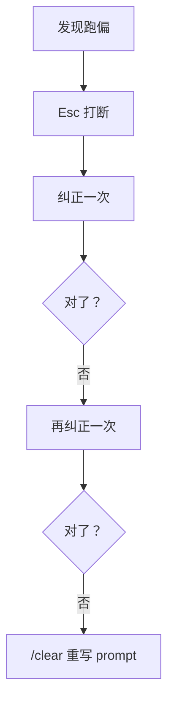

## Q
**纠偏 · interrupt、rewind、重开**｜摘要 · 必会

agent 正往错的方向改。你有哪三个动作？各在什么时候用？

## A
| 动作 | 效果 | 用在 |
|---|---|---|
| **interrupt**（Esc） | 立刻停下，保留到这一刻的一切 | 刚发现它跑偏，想补一句话 |
| **rewind**（`/rewind` 或连按两次 Esc） | 把代码、对话或两者回滚到之前某个提示 | 想试激进方案，不行就退回 |
| **重开**（`/clear`） | 清空对话，写一条更好的 prompt | 同一错误纠正两次仍不对 |

**为什么第三次纠正不如重开：** 前两次失败的尝试还留在 context 里，agent 每次都要重读它们；第三次纠正只是往一个已经含两次失败的对话里再加一层。`/clear` 加一条把教训折进去的新 prompt，几乎总是更好。

出处

Claude Code docs《Best practices》（Steer the session）

