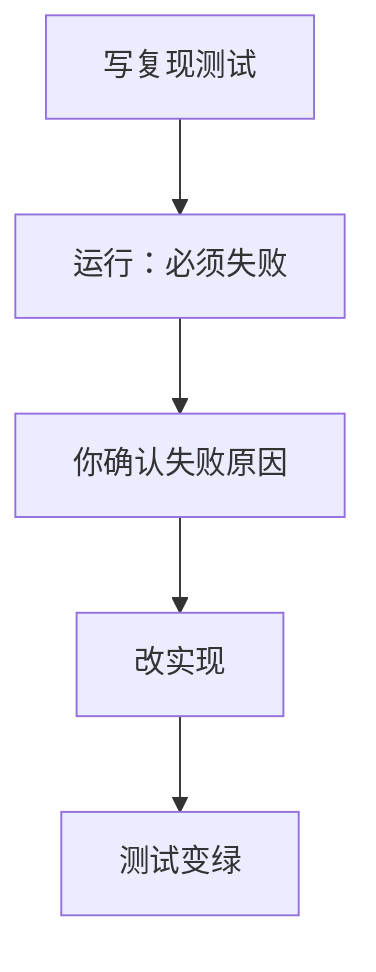

## Q
**TDD with agent · red → green**｜摘要 · 必会

让 agent 修 bug，它改完说"测试通过了"。你怎么设计流程，才能确定通过的测试真的在测这个 bug？

## A
**red → green：**
1. **red：** 让它先写一个复现 bug 的测试，**跑一遍，确认它失败**，且失败原因就是那个 bug；
2. **green：** 再让它改实现，直到这个测试通过；
3. 提交测试和修复。

**防什么：** 如果 agent 先改实现再写测试，那个测试可能从来没失败过——它只是在描述当前实现。**没见过红的测试不能证明任何事。**

**官方示例的写法：** "users report login fails after the session times out … write a failing test that reproduces it, then fix it"。

出处

Claude Code docs《Best practices》（Write a specific prompt：failing test 示例）

