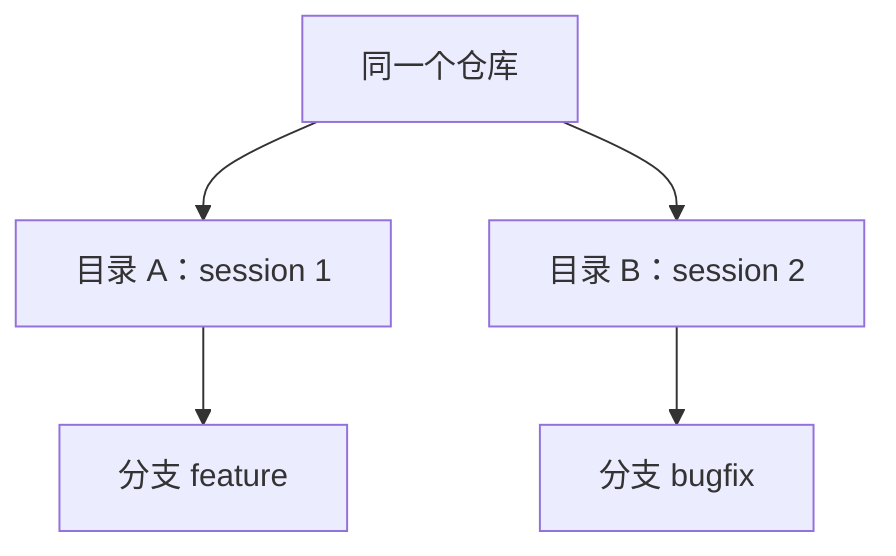

## Q
**并行 session 与 git worktree**｜摘要 · 必会

你同时开两个 agent session，一个做功能，一个修 bug，在同一个目录里，会出什么事？怎么避免？

## A
**问题：** 两个 session 编辑同一份工作区文件，互相覆盖，各自的测试跑在对方的半成品上。

**worktree：** git 的 linked worktree＝附属于同一个仓库的另一个工作目录，有自己的文件、HEAD 和 index，但共享历史和 refs。

```bash
git worktree add ../feature-auth       # 新目录 + 新分支 feature-auth
git worktree add ../fix-bug  bugfix    # 在新目录检出已有分支
git worktree list
git worktree remove ../feature-auth    # 只有干净的才能删
```



**限制：** 同一个分支不能同时在两个 worktree 里检出。

**工具里的对应（2026-11）：** `claude -w feature-auth` 在新 worktree 里开 session。

**出处：** git-scm.com《git-worktree》；Claude Code docs《Best practices》（Run sessions in parallel）
