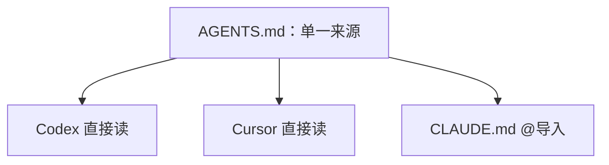

## Q
**Context file 的跨工具标准**｜摘要 · 追问

团队里有人用 Claude Code，有人用 Codex，有人用 Cursor。规则怎么只维护一份？

## A
| 工具 | 读什么 | 要点（2026-11 官方文档） |
|---|---|---|
| Claude Code | `CLAUDE.md`；没有 CLAUDE.md 时直接读 `AGENTS.md` | 同时有两者时只读 CLAUDE.md；想共用就在 CLAUDE.md 里 `@AGENTS.md` 导入 |
| Codex | `AGENTS.md`（及 `AGENTS.override.md`） | 从项目根往下走到当前目录，每层一个，拼接，越近越靠后；合计默认上限 32 KiB |
| Cursor | `.cursor/rules/*.mdc` 与 `AGENTS.md` | 规则有四种应用方式：总是、智能判断、按文件匹配、手动 @ |

**做：** 把共通规则写在 `AGENTS.md`；Claude Code 专有的（如 `/compact` 要保留什么）写在 `CLAUDE.md`，开头一行导入 `AGENTS.md`。
**别做：** 三份文件各写一遍，一两个月后互相矛盾。

出处

Claude Code docs《How Claude remembers your project》（AGENTS.md）；OpenAI Codex docs《AGENTS.md》；Cursor docs《Rules》

