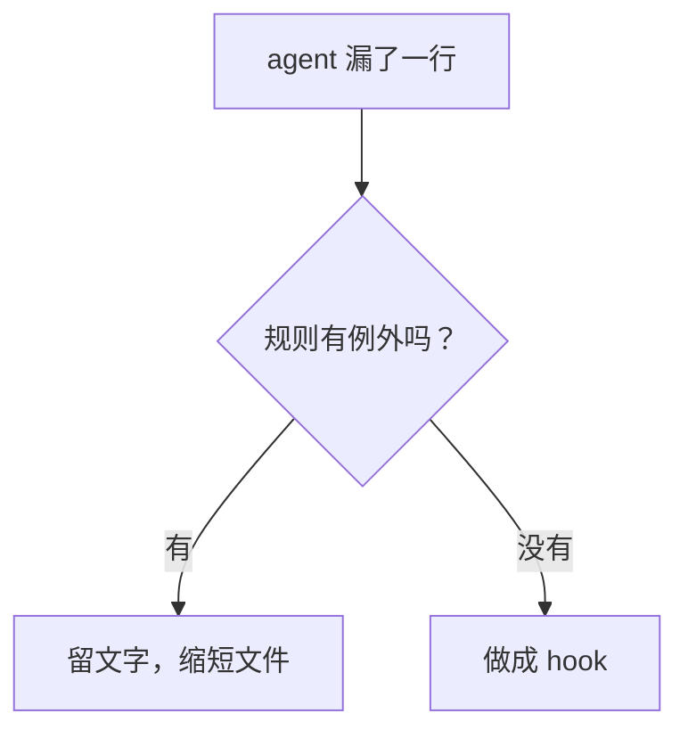

## Q
**Context file · agent 忽略了某一行**｜考点 · 必会

CLAUDE.md 里有一行"提交前跑 lint"，agent 时不时漏掉。你加了 IMPORTANT，还是漏。下一步是什么？

## A
**加强调通常没用。** 官方给出两种可能：

| 诊断 | 做法 |
|---|---|
| 文件长到这一行被淹没 | 删到更短；把只对一部分代码有用的行挪走 |
| 这是**没有例外的规则** | 换成 hook（见下一叶）：让 harness 执行，不是请求模型记得 |

**判断：** "提交前跑 lint"如果漏一次只是有点烦——留着，缩短文件；如果漏一次就会把坏代码推进 main——hook 或 CI。

**别做：** 把 IMPORTANT、ALWAYS、NEVER 堆满文件。强调越多，agent 越容易把每条规则都过度套用。

出处

Claude Code docs《Best practices》（Keep CLAUDE.md short：note）；《How Claude remembers your project》（CLAUDE.md vs auto memory：不是强制配置）

