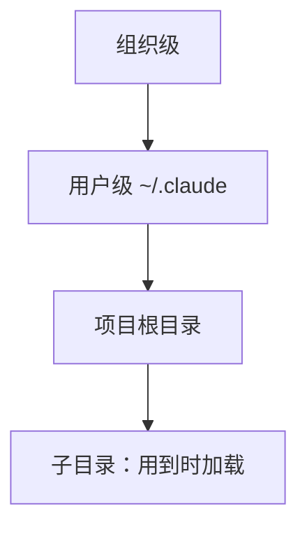

## Q
**写好 context file 的规则**｜摘要 · 必会

团队的 CLAUDE.md 一年里长到 600 行，agent 反而更常违反规则。该怎么治？

## A
| 规则 | 做法 |
|---|---|
| **具体可检验** | "run `pnpm tsc --noEmit` before finishing"，而不是"write clean code" |
| **短** | 官方建议每个文件低于 200 行；太长占 context，遵守率下降 |
| **不矛盾** | 两条冲突的指令，agent 可能任选一条；定期清理过时的、冲突的 |
| **按范围拆开** | 只对一部分代码有用的，放进只在相关文件被打开时才加载的路径规则 |
| **私人的放私人文件** | 个人偏好放不进仓库的 `CLAUDE.local.md`，加进 `.gitignore` |

**分层（Claude Code）：** 按"从宽到窄"加载，窄的后出现在 context 里：

全部**拼接**进 context，不是覆盖；所以别指望下层"覆盖"上层，冲突要自己消除。

**维护：** `/doctor prompt-audit` 会找出为旧模型写的指令、指向不存在文件的指令、互相矛盾的指令。

**出处：** Claude Code docs《How Claude remembers your project》（Write effective instructions；How CLAUDE.md files load）；《Best practices》
