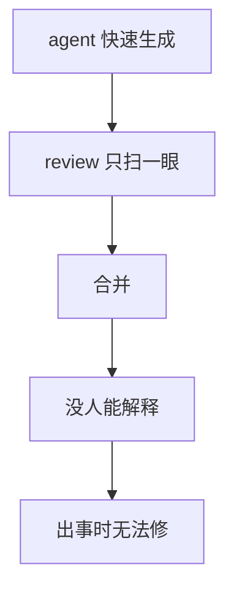

## Q
**Comprehension debt**｜摘要 · 必会

PR 过了 CI 和 review 就合并了。三个月后线上出问题，没人能解释这段代码为什么这样写。这是什么债？怎么防？

## A
**comprehension debt＝合并了、但没有任何人读懂的代码所积累的债。** 生成速度超过理解速度时产生：每个人都"看过"，没有人"懂"。

**和 technical debt 的区别：** technical debt 是你知道它不好；comprehension debt 是你不知道它是什么。

**规则：不能向同事解释的代码不合并。** 解释的检验：
- 它解决什么问题？为什么用这个方案而不是别的？
- 失败时会发生什么？
- 如果这块明天要改，从哪里下手？

**怎么做：** 变更小（才读得完）；让 agent 解释，然后**你复述并核对**；提交说明写"为什么"；没读懂的段落打回，或重写成更简单的。

**术语说明：** 这是业界近年的说法，没有统一定义，来源有争议；这里取上面的含义。

**出处：** 本叶概念的依据：DORA（软件交付研究项目）2025（AI 加速暴露下游弱点）；Stack Overflow Developer Survey 2025（几乎对但不对、调试更费时）
