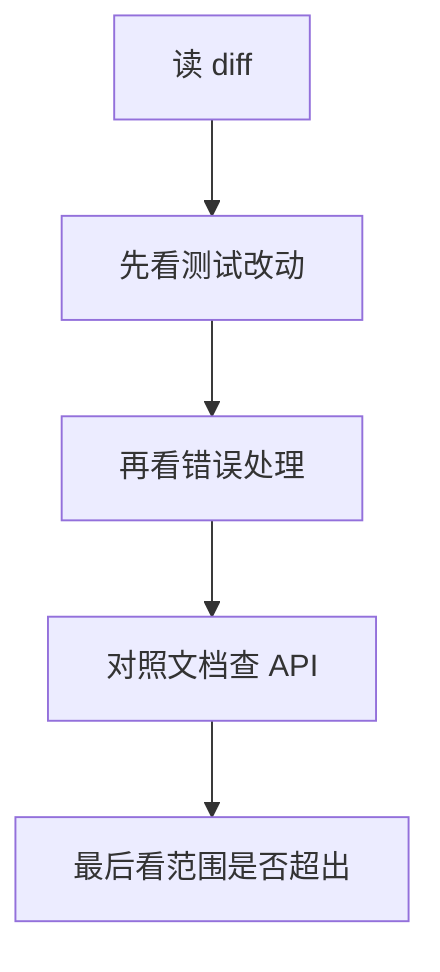

## Q
**AI 代码的五种典型缺陷**｜摘要 · 必会

review AI 写的 diff，要有针对性地找哪五类问题？各自怎么识别、怎么查？

## A
| 缺陷 | 识别特征 | 怎么查 |
|---|---|---|
| **几乎对但不对** | 主路径通过，边界（空值、并发、时区）错 | 看 spec 里列的边界是否都有测试；自己加一个边界用例 |
| **hallucinated API** | 调用不存在的方法、参数，或过时的用法；编译型语言会报错，动态语言要到运行时 | 对照官方文档和锁定的版本；跑一遍 |
| **吞掉错误** | 空的 `catch`、`except: pass`、返回默认值掩盖失败 | 搜索 catch/except 块；故意制造失败看日志 |
| **over-engineering** | 为一个调用点加了接口、工厂、配置项 | 问"现在有几个调用者"；超出 spec 的东西删 |
| **悄悄改测试** | 测试文件在 diff 里，断言被放宽或用例被删 | 先读测试文件的改动 |

**为什么这五类：** 它们的共同点是"看上去对"。AI 的输出流畅、风格统一，所以看起来合理不再是信号。

**出处：** Stack Overflow Developer Survey 2025（AI：几乎对但不对）；Claude Code docs《Best practices》（Review against your spec：reviewer 总会找到点什么）
