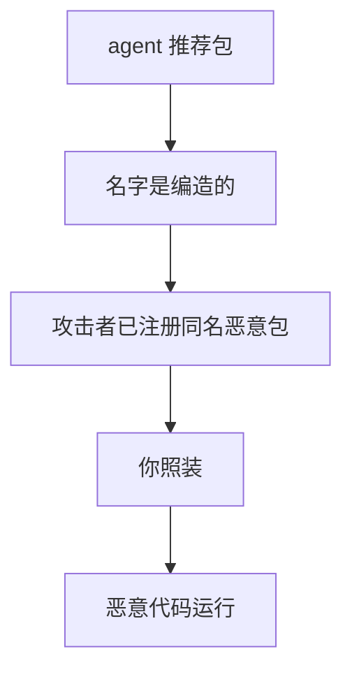

## Q
**Dependency 核实 · slopsquatting**｜摘要 · 必会

agent 在 `requirements.txt` 里加了一个你从没听过的包 `fastjson-utils`，说"用来解析 JSON"。你该怎么办？

## A
**LLM 会编造听起来合理的包名（package hallucination）。** **slopsquatting**＝攻击者把这些被编造的名字抢先注册成恶意包，等开发者照着 AI 的建议安装。

**证据：** Spracklen 等人（USENIX Security 2025）测了 16 个代码生成模型、共 576,000 个代码样本：商业模型平均至少 5.2%、开源模型 21.7% 的推荐包不存在；共出现 205,474 个不同的编造名字。

**安装前核实：**

| 查什么 | 怎么查 |
|---|---|
| 它真的存在、是你要的那个 | 在包仓库页面和官方文档里找；对照项目主页和源码仓库 |
| 不是刚注册的 | 发布时间、版本历史、维护者 |
| 版本匹配 | 对照锁文件（lockfile）和官方文档里的写法 |
| 有没有现成依赖 | 项目里已有的库先用 |

**时效：** 2026 年有后续研究对前沿模型复测，报告的比例低得多，但威胁依然存在；比例会随模型变，"先核实再安装"不变。

**出处：** Spracklen et al.《We Have a Package for You!》，arXiv:2406.10279（USENIX Security 2025）
