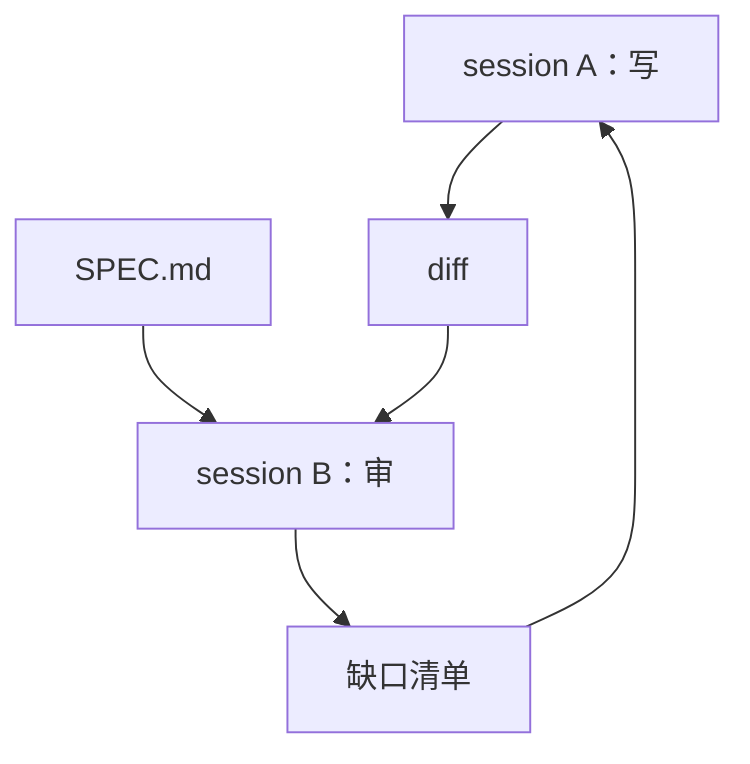

## Q
**独立 reviewer**｜摘要 · 必会

写代码的 session 说"我检查过了，没问题"。为什么还要另一个 session 来审？

## A
**写代码的 session 的 context 里有它自己的推理。** 让它审自己的代码，会被同一套推理说服（自我认同）。**全新 context 的 reviewer 只看差异和规格**，没读过它是怎么写出来的。

**怎么做：**
- 开第二个 session，让它读 diff 和 spec；你把它的发现贴回第一个 session；
- Claude Code 里的 `/code-review` 在一个**从没见过你对话**的 subagent（在自己独立 context 里干活的 agent）里审 diff；
- 还可以给 reviewer 只读工具（官方示例：只给 Read、Grep、Glob），"不能编辑"是由 harness 强制，不是靠提示。

**审查 prompt 要对照 spec：** "逐条看需求是否实现、列出的边界是否有测试，只报影响正确性的缺口，跳过风格。"

**注意：** 同一个模型审同一个模型有共同盲点；关键代码加一位人，或换另一个模型。

**出处：** Claude Code docs《Best practices》（Give Claude a check to run；Run sessions in parallel）
