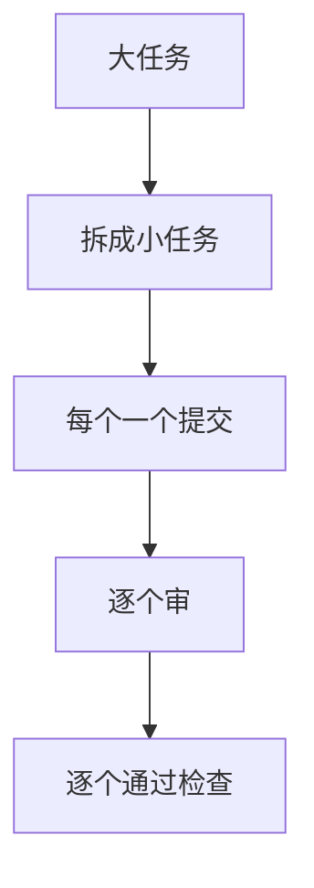

## Q
**Small-diff review**｜摘要 · 必会

agent 交来一个 3000 行的 PR："实现了新的结算流程"。你该怎么办？

## A
**拒绝按这个体量审。** 没人能认真读完 3000 行；没读懂的东西合并了，就成了 comprehension debt（见下文）。

| 做 | 怎么做 |
|---|---|
| 限制变更体量 | 在 prompt 和流程里要求：一个任务一个提交，每块 diff 一个人能读完 |
| 机械和行为分开 | 改名、格式化单独提交；逻辑改动单独提交 |
| 逐段读 | 先读测试的改动，再读实现；每段能说出"它为什么在这" |
| 强制拆分 | 超过团队约定体量的 PR 打回，不论是谁（或哪个 agent）写的 |

**让 agent 帮你拆：** "按下面顺序拆成独立可审查的提交：新增类型、迁移调用点、删除旧代码，每个提交单独通过测试"。

**别做：** 让另一个 agent 来"总结这 3000 行"然后只读总结——总结是模型的文本，不是你读过的证据。

出处

Claude Code docs《Best practices》（Run sessions in parallel：/batch 拆成独立单元，各自一个 PR）

