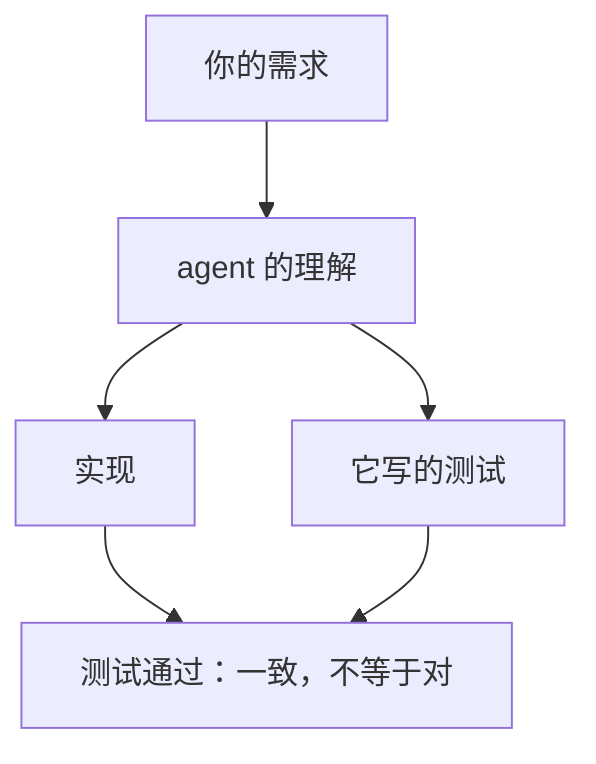

## Q
**Tests as contract**｜摘要 · 必会

agent 同时写了实现和测试，全绿。为什么这不能证明实现是对的？

## A
**生成者同时定义了"对"和"做到了"。** 如果它对需求理解错了，实现和测试会**一致地错**——测试验证的是它的理解，不是你的需求。

**做：**
- **验收测试由人写，或由人审**：测试代表合同；agent 只写实现；
- 其他测试可以让 agent 写，但先确认**它们曾经失败过**（red → green）；
- 用检验测试质量的方法：**变异测试**（mutation testing：自动把实现改坏，看测试能否发现）、**属性测试**（property-based testing：不写具体例子，写"对任意输入都应成立的性质"，由工具生成大量输入）。

**别做：** 让同一个 session 先写实现，再"为它写测试"。

**出处：** Claude Code docs《Best practices》（Give Claude a check to run；Review against your spec）
