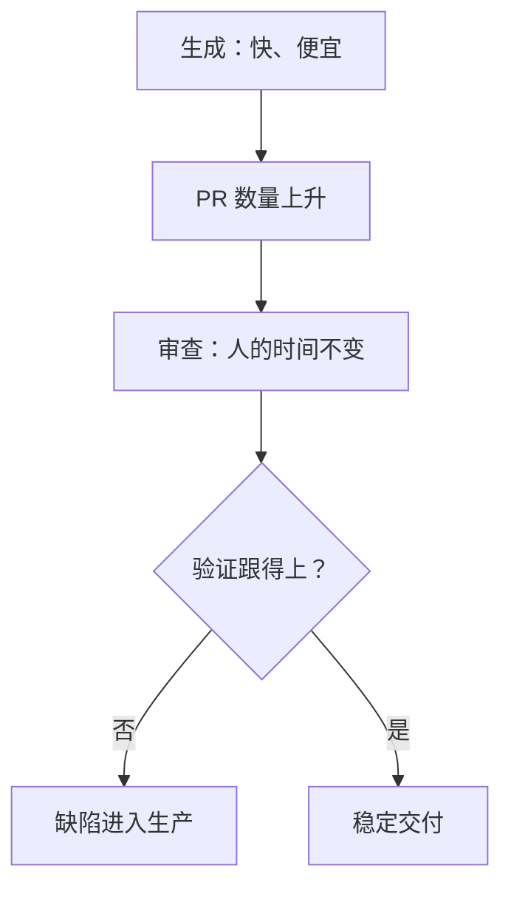

## Q
**Verification 优先于 generation**｜摘要 · 必会

agent 让团队一周的 PR 数翻了一倍，但上线后的事故也变多了。瓶颈在哪？

## A
**生成变便宜了，限制产出的变成阅读和验证。**

**证据（两个独立来源）：**
- **DORA（Google Cloud 的软件交付研究项目）2025：** 采用 AI 现在与交付 throughput（吞吐）正相关，但仍与交付稳定性负相关；报告的解读是，没有强的自动化测试、成熟的版本控制和快速反馈回路，变更量越大越不稳定。
- **Stack Overflow 2025：** 66% 的受访者最大的困扰是"AI 给出的方案几乎对但不对"，45.2% 说调试 AI 生成的代码更费时。

**所以要做的是把审查变成流程：** 自动检查先挡一道（测试、type check、lint、CI）；人的审查聚焦在自动检查看不到的地方（需求是否被理解对、边界、设计）；变更足够小才读得完（下一张）。

**别做：** 靠"大家认真看一眼"。

**出处：** DORA《2025 State of AI-assisted Software Development》（Google Cloud 博客，2025-09-23）；Stack Overflow Developer Survey 2025（AI）
