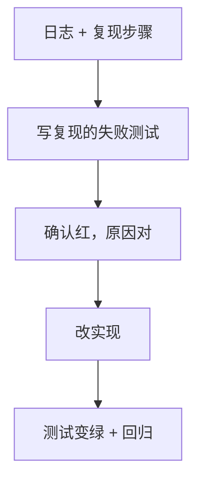

## Q
**用 AI 复现并定位 bug**｜实践 · 必会

线上报错"登录会话超时后失败"。怎么给 agent 材料，让它先复现、再修？

## A
**材料（越具体越好）：**

| 给 | 例 |
|---|---|
| 症状 | users report login fails after the session times out |
| 范围 | look at token refresh in src/auth/ |
| 日志 | 把 error.log 用管道交给 `claude -p`（官方示例） |
| 复现步骤 | 登录 → 等 31 分钟 → 刷新页面 |
| "修好"的判据 | 写一个会失败的测试复现它，再修 |

**为什么先复现：** 没有复现，"修好"就没有判据；agent 会改一处看起来相关的代码，说"应该好了"。有了红的测试，它能自己循环到变绿。

**别做：** 只贴报错一句话，让它"修一下"；或让它直接改代码。

出处

Claude Code docs《Best practices》（Write a specific prompt：fix the login bug 对照）

