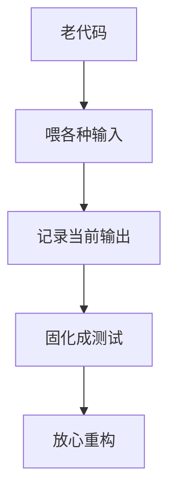

## Q
**Legacy code · characterization tests**｜实践 · 必会

一个没人敢动的 800 行老函数，你想重构，但没有测试，也没人说得清它"应该"怎么工作。第一步做什么？

## A
**characterization test＝把代码当前的实际行为记录成测试**，不管它对不对。目的：重构时，只要行为变了，测试就红。

**做：**
1. 让 agent 读函数，列出输入空间的代表点（正常、边界、异常）；
2. 对每个输入**运行现有代码**，把实际输出写成断言；
3. 你审：明显是 bug 的行为，**也先记录**，加注释"已知问题"，重构后再单独修；
4. 测试全绿后才开始重构，一次一小步，每步重跑。

**为什么适合 AI：** 批量、重复、需要耐心——枚举输入、跑、写断言。

**别做：** 让 agent 一边重构一边"顺便修 bug"，行为改变就分不清是故意的还是意外的。

出处

概念；批量机械工作的拆分依据 Claude Code docs《Best practices》（Run sessions in parallel）

