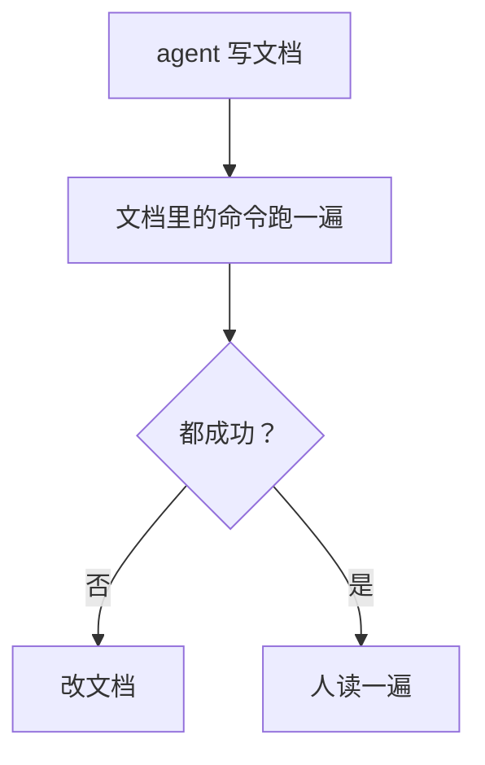

## Q
**Docs、comments 与 change description**｜实践 · 追问

agent 能很快生成 README、注释和 PR 描述。怎么避免文档变成"流畅但错误"的东西？

## A
**生成再校对，并把校对变成检查。**

| 对象 | 风险 | 做法 |
|---|---|---|
| **README / 文档** | 描述的命令、参数不存在 | 把文档里的代码块当测试跑（doctest 或脚本）；让 agent 引用真实文件路径 |
| **注释** | 重复代码在做什么，却不写**为什么**；代码改了注释没改 | 注释只写为什么；审查时看改了代码的地方旁边的注释是否还对 |
| **change description（PR 描述）** | 概括的是它"想做"的，不是 diff 实际做的 | 要求描述对照 diff；你读 diff，不只读描述 |

**漂移检查：** CI 里加一步：文档示例能运行、链接有效；改代码的 PR 要同时改文档。

**出处：** Claude Code docs《Best practices》（What you can stop doing：Describe your architecture in CLAUDE.md；只写 Claude 读不出来的东西）
