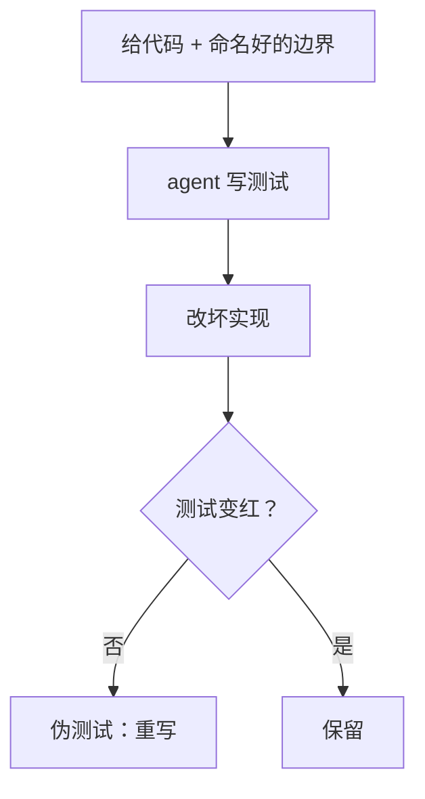

## Q
**生成 unit tests**｜摘要 · 必会

让 agent 给一个函数"补单元测试"。什么时候效果好，什么时候给你一堆没用的测试？

## A
**前提：被测代码清晰。** 函数职责单一、输入输出明确、副作用少，agent 才能推出该测什么；一个 300 行、到处读全局状态的函数，它只能照着实现抄一遍。

| 好的测试 | 伪测试 |
|---|---|
| 断言**行为**：给定输入，结果是什么 | 断言**实现**：某个内部函数被调用了几次 |
| 覆盖路径和边界：空、零、最大、非法、重复 | 只测"正常路径"一个例子 |
| 能失败：改坏实现会变红 | 永远绿：mock 把被测逻辑替换掉了 |

**做：** 在 prompt 里列出要覆盖的边界（"空列表、负数、重复 key"），要求用现有测试文件的风格；然后自己**临时改坏实现**验证测试会红。
**别做：** 只看覆盖率数字。

**出处：** Claude Code docs《Best practices》（Write a specific prompt：follow the pattern in…；Give Claude a check to run）
