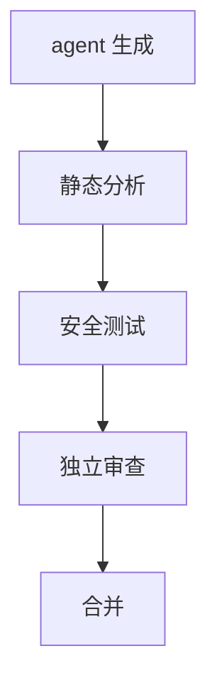

## Q
**AI 生成代码的 security 缺陷**｜摘要 · 追问

AI 生成的代码在安全上常见哪些问题？怎么把检查并进流程？

## A
| 类别 | 例 |
|---|---|
| **注入** | 字符串拼接 SQL、命令、HTML |
| **鉴权缺失** | 新接口忘了权限检查；只在前端校验 |
| **弱加密** | 过时的哈希（MD5）、自造加密、硬编码密钥 |
| **不安全默认值** | `verify=False`、CORS 全开、调试模式、宽松的文件权限 |

**为什么：** 模型学的是大量公开代码，其中就有这些写法；而功能测试看不到它们，所以"能跑"不代表安全。

**并进流程：**

- 静态分析（SAST）和依赖扫描进 CI，作为 check；
- 针对攻击输入的测试（注入串、越权请求）；
- 审查清单：每个新接口问"谁能调用、校验了什么"；
- 工具里的对应（2026-11）：Claude Code 有 `/security-review`，对当前分支的改动做一遍安全检查。

**别做：** 让生成者自己说"我检查过安全"。

**出处：** Claude Code docs《Security》（Related resources：/security-review）
