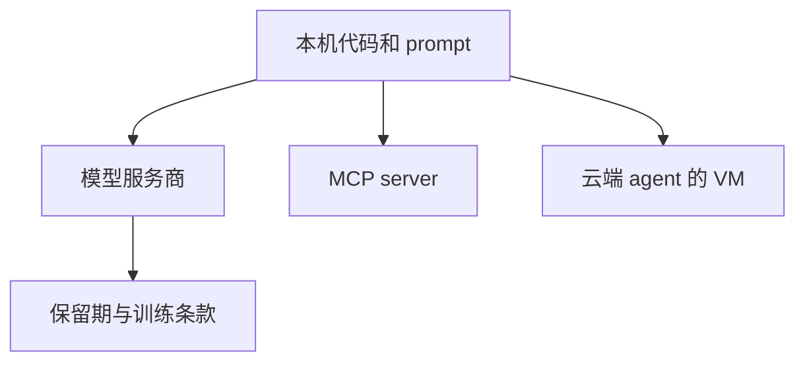

## Q
**Data exfiltration 与企业 compliance**｜摘要 · 追问

合规部门问："我们的代码会发到哪里？存多久？能不能不出公司网络？"你怎么回答？

## A
**先画出数据流：** 你的代码、prompt、读进 context 的文件，在每次请求时发往模型服务商。

| 问 | 去哪找答案 |
|---|---|
| 发往哪个供应商 | 你启用了哪些工具、哪些 MCP server |
| 存多久、是否训练 | 供应商的 commercial terms 和隐私页面；不同计划不同 |
| 云端 agent 的网络与凭据 | Claude Code 云端默认受限网络，可只允许指定域名；Cursor 云端 agent 的秘密按团队范围注入，管理员可限制出站域名 |
| 能否私有部署 | 看是否有通过自有云账号（云厂商）或自托管环境的方式 |

**做：** 用 managed settings 统一规定：哪些 MCP server 可用、哪些目录不可读、哪些网络域名允许；用 OpenTelemetry 监控用量。
**别做：** 依赖个人"自觉"。

**时效（2026-11）：** 具体的保留期和部署选项变化快，以供应商当下条款为准，这里只给结构。

出处

Claude Code docs《Security》（Cloud execution security；Team security）；Cursor docs《Cloud Agents》（Security notes）

