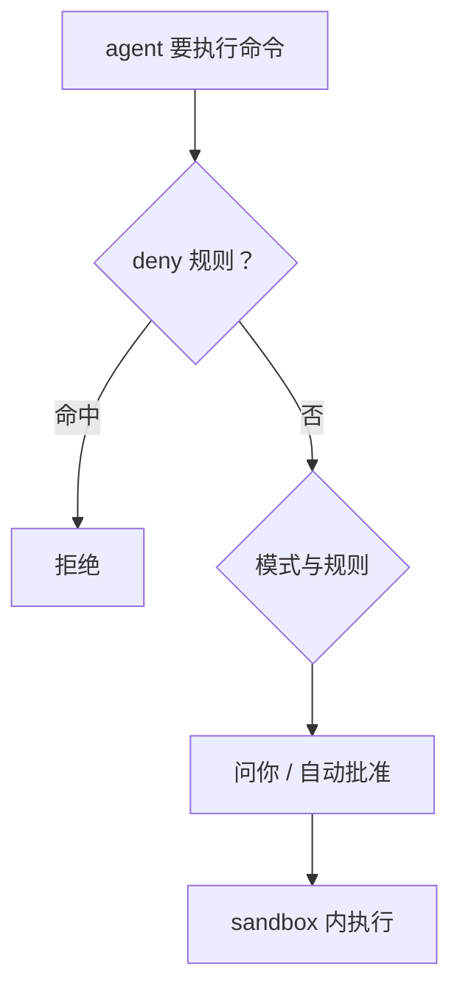

## Q
**Permission model 与 sandbox**｜摘要 · 必会

agent 每个命令都问你，你按到手酸，于是想直接"跳过所有确认"。permission model 提供了哪些档位？边界在哪？

## A
**permission mode（权限模式）决定 agent 不问你就能做什么**（Claude Code，2026-11 官方文档）：

| 模式 | 行为 |
|---|---|
| **Manual** | 默认只读；改文件、跑命令前问你 |
| **Accept edits** | 自动编辑工作目录内的文件和少数文件系统命令，其余仍问 |
| **Plan** | 只探索和提计划，不改源文件 |
| **Auto mode** | 另一个分类器模型审每个动作，拦下它认为不安全的，不再问你 |

**规则：** allow / ask / deny 三种。**deny 规则在所有模式下都生效，包括 auto 和跳过确认（bypassPermissions）**。

**sandbox＝限制 shell 命令能访问的文件系统和网络的运行环境（操作系统级隔离）。** 工作目录边界本身只是个**提示**：你批准的一条 Bash 命令，仍可能写你账户能写的任何地方；要在系统层面限制，开 sandbox。

**边界：** auto mode 连续被拦 3 次（或累计 20 次）会暂停并回到询问；它是分类器，不是保证。

**出处：** Claude Code docs《Security》（Permission-based architecture；Built-in protections）；《Best practices》（Limit access；Change a default）
