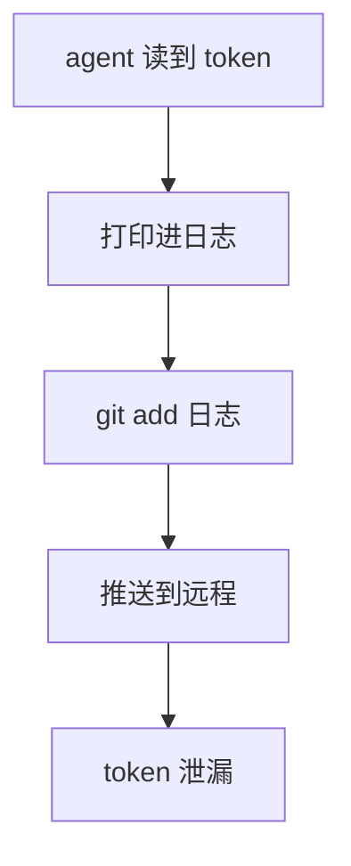

## Q
**Secrets · 一次泄漏的路径**｜考点 · 必会

agent 在调试一个 401，把请求头（含 `Authorization: Bearer …`）打印到了日志文件，然后提交了这个日志文件。梳理泄漏路径，每一步在哪里能阻断？

## A

| 步骤 | 阻断点 |
|---|---|
| 读到 token | 凭据权限最小；deny rule 让它读不到 `.env` |
| 打印进日志 | 日志脱敏；prompt 里写"不要打印凭据"（建议性，不够） |
| 提交日志 | `.gitignore` 排除日志目录；pre-commit hook 扫描密钥（确定性） |
| 推送 | 服务端 secret scanning；分支保护 |

**补救：** 只要推送过，就**当作已泄漏**：立刻轮换凭据，再清理历史。删掉文件不会让泄漏的 token 恢复安全。

**别做：** 只删文件。

**出处：** Claude Code docs《Best practices》（Enforce steps with hooks：扫描提交中密钥的 hook 示例，onFailure block）
