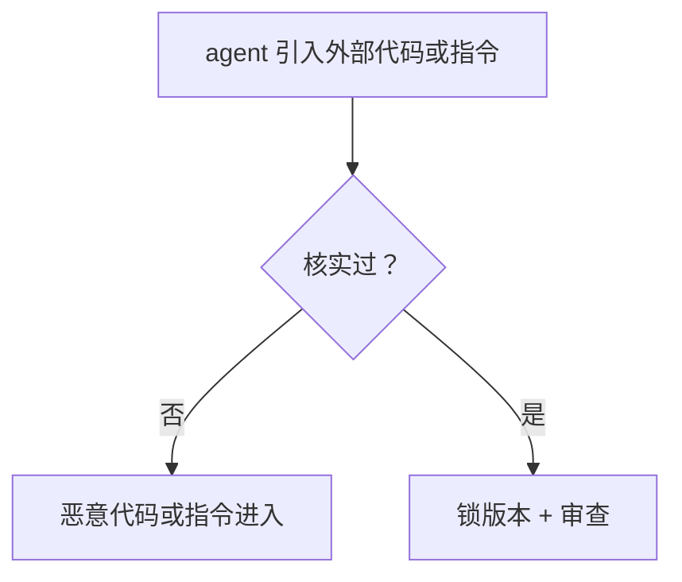

## Q
**Supply chain 风险**｜摘要 · 必会

agent 能装包、能装第三方 skill（按需加载的流程说明）、能连 MCP（让 agent 连接外部服务的协议）server。供应链上有哪四类风险？先做什么？

## A
| 类型 | 机制 | 先做 |
|---|---|---|
| **hallucinated package** | 模型编造包名，攻击者抢注（slopsquatting，t04） | 安装前核实存在、来源、发布时间 |
| **malicious package** | 真实存在但带恶意的包（含安装时执行的脚本） | 锁版本；审查新增依赖；最小权限的 CI |
| **被投毒的 skill** | skill 是会被读进 context 当指令的文字，恶意内容能指挥 agent | 装之前自己读；只用可信来源 |
| **被投毒的 MCP server** | server 提供的工具说明和返回值都进 context，还能执行动作 | 自己写，或只用你信任的提供方；`.mcp.json` 的批准提示别无脑点 |

**官方态度：** Anthropic 审查连接器是否符合上架标准，但**不对任何 MCP server 做安全审计**；建议自己写或用信任的提供方。

出处

Claude Code docs《Security》（MCP security）；Spracklen et al.，arXiv:2406.10279（package hallucination）

