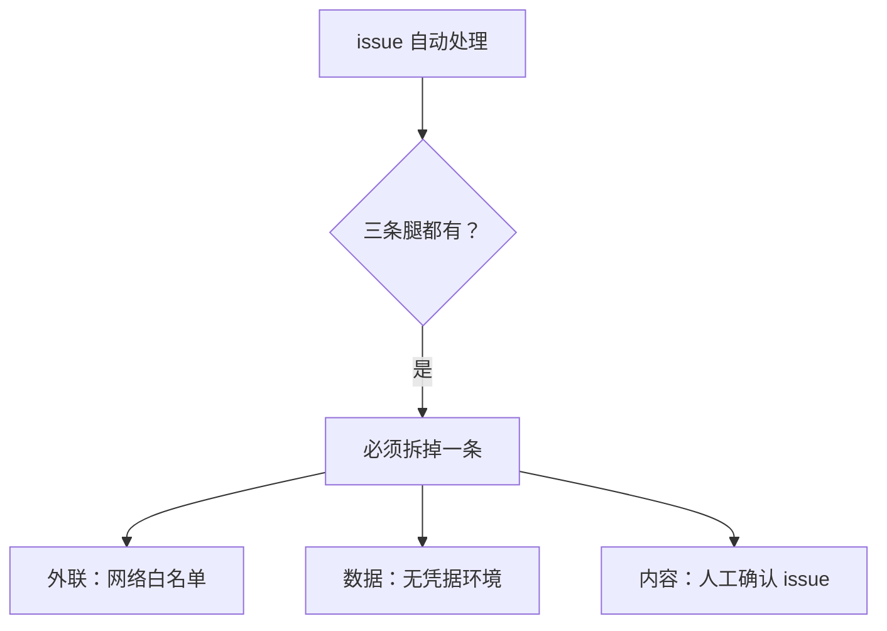

## Q
**Trifecta · 拆掉一条腿**｜实践 · 必会

你想让 agent 自动处理外部用户提交的 issue：读 issue、改代码、开 PR。目前它有仓库权限、能读 issue、能联网。怎么改，让它不再同时拥有三条腿？

## A
| 拆哪条腿 | 做法 | 代价 |
|---|---|---|
| **私有数据** | 在一次性环境里跑，不挂凭据；只给只读的公开仓库副本 | 它不能访问内部资源 |
| **不可信内容** | 只处理已被人确认过的 issue；或先让一个**无工具**的步骤只做摘要 | 多一道人工或步骤 |
| **外部通信** | 沙箱网络只放行包仓库；`curl`、`git push` 走人工批准 | 它不能自己联网查东西 |

**做：** 最容易的往往是拆**外联**（网络出口白名单）加拆**私有数据**（专用环境不放凭据）。
**别做：** 加一个"检测恶意 issue"的 guardrail 就算完事——检出率不是 100%。

出处

Simon Willison《The lethal trifecta for AI agents》（2025-06-16）；Claude Code docs《Security》（Network command approval；sandbox network isolation）

