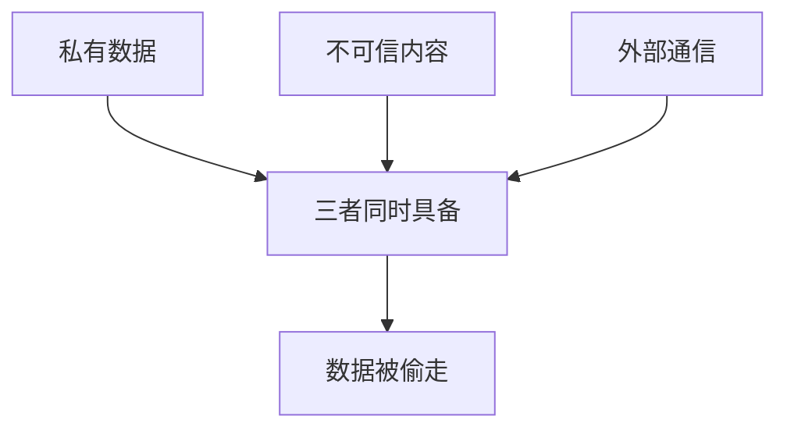

## Q
**Lethal trifecta**｜摘要 · 必会

三个能力放在同一个 agent 里就很危险。是哪三个？coding agent 里分别对应什么？

## A
**lethal trifecta（Simon Willison，2025-06-16）：一个会用 tool 的 LLM 系统同时具备下面三项，攻击者就能骗它偷你的数据。**

| 腿 | 一般含义 | coding agent 里 |
|---|---|---|
| 访问**私有数据** | 通常也是你给它工具的原因 | 私有代码、`.env`、云凭据、ssh key |
| 暴露于**不可信内容** | 攻击者能放文字或图片到模型会读的地方 | README、依赖、issue、网页、MCP 返回值 |
| **外部通信** | 任何能把数据带出去的通道 | `curl`、`git push`、发请求的 MCP（外部服务连接协议）tool、带数据的链接 |

**Willison 的建议：** 完全避免这三者的组合。厂商能在自己的产品里堵住一些路径，但你自己混搭工具后，没人能替你保护。

**MCP 让它更容易发生：** 它鼓励你混搭来自不同来源的工具，这些工具里常常有的提供私有数据、有的带来不可信内容、有的能外联。

**出处：** Simon Willison《The lethal trifecta for AI agents》（2025-06-16）
