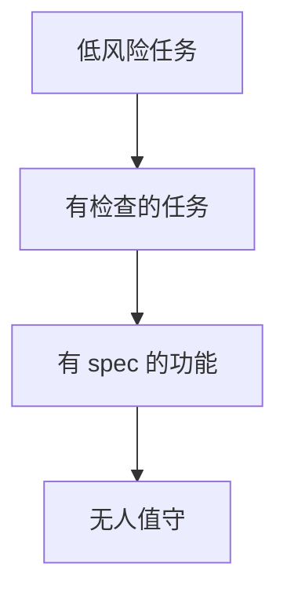

## Q
**Adoption 路径**｜实践 · 必会

团队 40 人，要引入 coding agent。从哪里开始、怎么扩大？

## A
**从低风险、有检查、好回退的任务起步：**

| 阶段 | 任务 | 为什么 |
|---|---|---|
| 1 | 写测试、文档、小范围重构 | 有明确判据；错了影响小 |
| 2 | 迁移、批量机械改动 | 脚本化，每批一个检查点 |
| 3 | 小功能（有 spec 和测试） | 开始需要审查流程 |
| 4 | 更自主的运行（后台、定时） | 前提：前面的检查和权限都已就位 |

**配套：**
- 培训：同一批任务上互相演示 prompt、context file、审查做法；
- 把个人技巧变共享资产（CLAUDE.md、skills（按需加载的流程说明）、权限配置放进仓库）；
- 每个阶段前先建基线，阶段后复盘；
- 无人值守之前过五问：它知道什么叫完成吗？能自检吗？能碰什么？什么让它停？结果交给谁签字？

**别做：** 第一周就让 agent 动支付核心或生产部署。

**出处：** Claude Code docs《Best practices》（Let Claude run without you：五问）；DORA 2025（基础先行）
