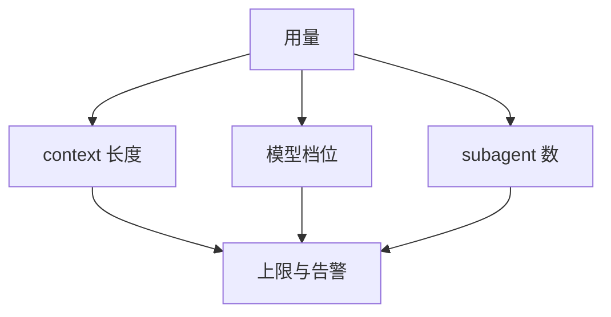

## Q
**成本管理 · token budget、tiering、subagent（独立 context 里干活的 agent）**｜摘要 · 必会

月底账单是预期的三倍。成本的机制是什么？该在哪里设上限？

## A
**钱花在 token 上，而 token 的量由三件事决定：**

| 因素 | 机制 | 控制 |
|---|---|---|
| **context 长度** | 每次请求都把**整个对话**重发；同一个 session 塞三个无关任务，第四个任务每一轮都在重读前三个 | 任务间 `/clear`；`/compact` 带重点 |
| **模型档位** | 强模型每个 token 更贵 | 规划用强，机械活用快的小模型，subagent 用小模型 |
| **subagent 数量** | 每个 subagent 发自己的请求，都计入同一份用量 | 要求回传简短摘要；`/usage` 看占比 |

**缓存：** 缓存热时重发有折扣，过期后全价。官方文档（2026-11）：订阅约 1 小时、API key 等约 5 分钟。

**上限与可见性：**
- 无头运行：`--max-turns`、`--max-budget-usd`；
- 账户级：设 spend limit；
- 看板：`/usage` 按 skill（按需加载的流程说明）、subagent、plugin、MCP（外部服务连接协议）server 拆分；
- 后台任务（`/loop`、goal 检查、subagent）也在持续消耗，你没打字时也在算。

出处

Claude Code docs《Best practices》（Keep cost and context down；Know what delegation costs；Let Claude run without you）

