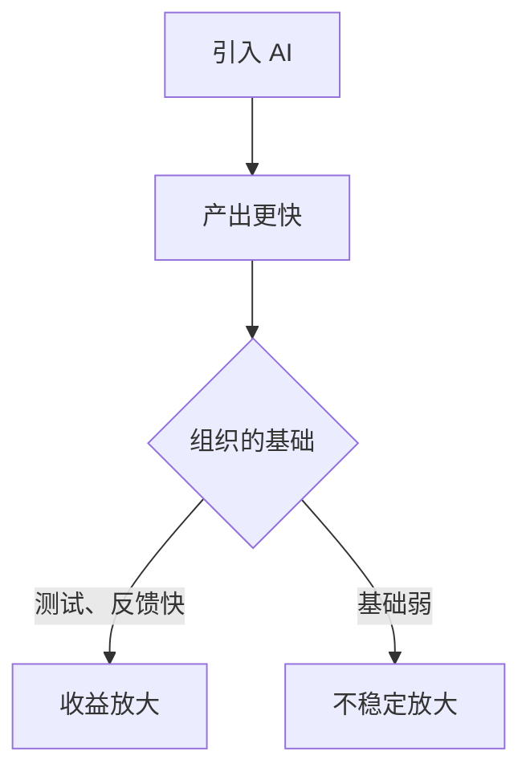

## Q
**证据 2 · DORA 2025**｜摘要 · 必会

DORA（Google Cloud 的软件交付研究项目）2025 年的 AI 辅助开发报告，最核心的结论是什么？

## A
**核心：AI 是放大器（amplifier）——放大组织已有的强项和弱点。** 报告的话："AI 不会修好一个团队，它放大那里已有的东西"；加速开发的同时，加速也会在下游暴露弱点。

| 事实（2025-09-23 发布） | 数据 |
|---|---|
| 样本 | 近 5,000 位技术从业者，外加 100+ 小时定性数据 |
| 使用 | 90% 在工作中使用 AI；80% 以上认为提高了个人生产力 |
| 吞吐 | 与交付 throughput、产品表现正相关（与 2024 不同） |
| 稳定性 | 仍与交付稳定性**负相关**；没有强自动化测试、成熟版本控制和快速反馈回路，变更量增加就引发不稳定 |
| 信任 | 30% 几乎不信或不信 AI 生成的代码 |

**配套：** DORA AI Capabilities Model，共七项能力，描述放大 AI 收益的做法（页面更新于 2025-11-25）。具体七项名称，以原报告为准。

**所以：** 投资 AI 之前先看**基础**（测试、CI、版本控制、反馈速度）。

**出处：** DORA《2025 State of AI-assisted Software Development》（Google Cloud 博客公告，2025-09-23；dora.dev）
