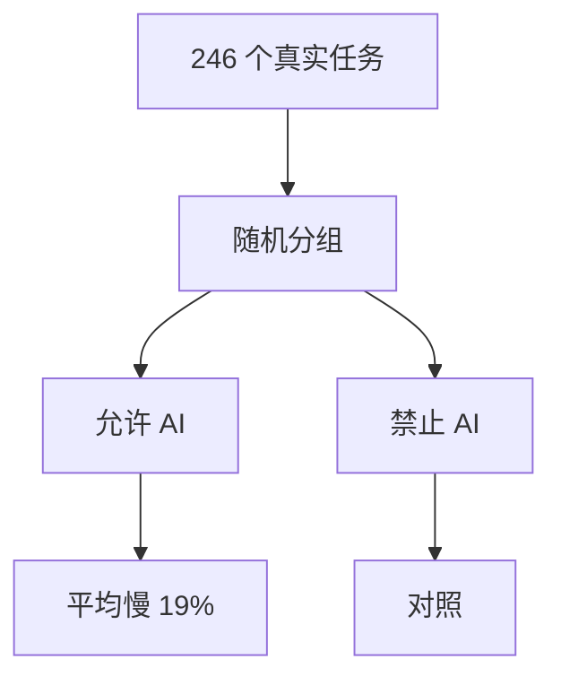

## Q
**证据 1 · METR 2025 RCT**｜摘要 · 必会

"AI 让开发者快 20–50%"满天飞。METR 2025 年做的随机对照实验（RCT）测出了什么？

## A
**RCT（randomized controlled trial）＝把任务随机分成"允许用 AI"和"不允许用 AI"两组，比较完成时间。** 随机分配让两组任务在统计上可比。

**METR（一家独立的 AI 评测机构）2025-07-10 发布：**

| 项 | 数据 |
|---|---|
| 参与者 | 16 位有经验的开源开发者 |
| 任务 | 246 个真实 issue，平均约 2 小时，每个随机允许或禁止 AI |
| 仓库 | 平均 22k+ star、100 万行以上代码，开发者多年贡献过 |
| 工具 | 主要是 Cursor Pro 加 Claude 3.5/3.7 Sonnet（当时的前沿模型） |
| 结果 | 允许 AI 时任务**多花 19% 的时间**（置信区间 +2% 到 +39%） |
| 预期 | 开发前预测会快 24%；做完后仍认为快了约 20% |

**局限（METR 自己列出）：** 只有 16 人，可能无法推广或复现；熟悉的大仓库、2025 年初的工具；预期收益大的开发者可能不愿参加；超过约 50 小时的 Cursor 学习效应不能排除；**不能说明 AI 对新手或陌生代码库没有帮助。**

**最重要的一点：METR 在原文页面上写明"这些结果已过时"**（见下一张）。

出处

METR《Measuring the Impact of Early-2025 AI on Experienced Open-Source Developer Productivity》（2025-07-10）

