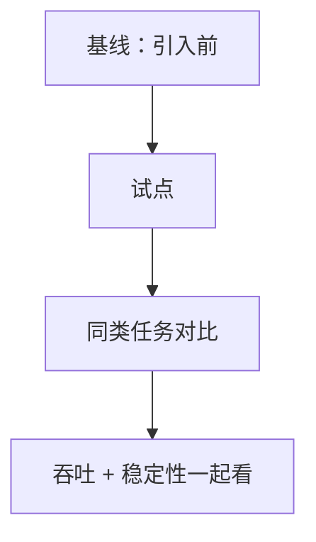

## Q
**该度量什么**｜摘要 · 必会

管理层想用"AI 生成的代码行数""建议接受率"衡量效果。你建议度量什么？

## A
**这两个是活动指标，不是结果指标：** 生成多、接受多，不等于交付更好。

| 指标 | 定义 | 说明什么 |
|---|---|---|
| **cycle time** | 从开始做到上线的时间 | 吞吐；要在计入审查和等待之后量 |
| **change failure rate** | 上线的变更中，导致故障或要回滚的比例 | 质量与稳定性 |
| **recovery time** | 出故障后恢复的时间 | 韧性；AI 写的代码没人读懂时会拉长 |
| **rework** | 合并后被返工、改回或重做的比例 | 隐藏成本；"几乎对但不对"的体现 |

**为什么要成对看：** DORA 2025 的核心现象是吞吐上去、稳定性不一定跟上。只看 cycle time 会漏掉 change failure rate 的恶化。

**先建基线，再比较：** 引入 AI 之前量几周，试点后在同类任务上对比；不同类型的任务分开看。

**出处：** DORA《2025 State of AI-assisted Software Development》（throughput 与 instability 的关系）
