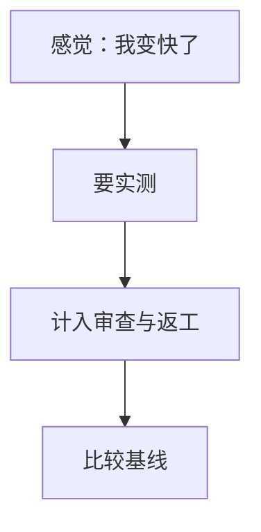

## Q
**Perception vs measurement**｜摘要 · 必会

METR 的开发者做完任务后仍认为 AI 让自己快了 20%，实测却慢了 19%。为什么自我感觉不可靠？

## A
**事实：** 预测快 24%，事后认为快 20%，实测慢 19%——感觉和测量方向相反。

**可能的原因（假设，METR 分析过 20 个可能因素，其中 5 个可能造成变慢，具体以原文为准）：**

| 感觉到的 | 容易被忽略的 |
|---|---|
| 写出的代码多、起步快 | 等待 agent 的时间 |
| 一直在"推进" | 切换上下文、重新读它做的东西 |
| 它的方案流畅 | 审查、修正"几乎对但不对"的成本 |
| 省了敲键盘 | 熟悉的大仓库里，你本来就很快 |

**所以需要实测：** 同一类任务、同样的完成标准下，比较有无 AI 的耗时，并计入审查和返工。

**2026 年的补充：** METR 更新里发现，同时跑多个 agent 的开发者，计时本身也不可靠——另一个"测量难"的例子。

出处

METR《Measuring the Impact of Early-2025 AI…》（2025-07-10）；METR《We are Changing our Developer Productivity Experiment Design》（2026-02-24）

