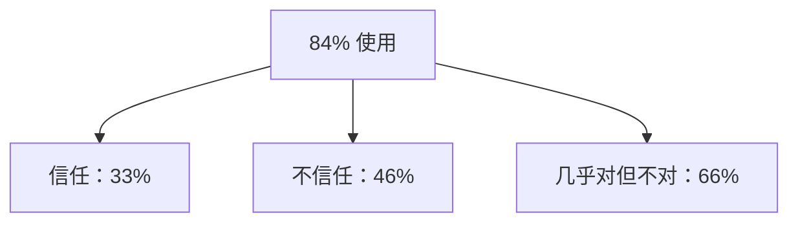

## Q
**证据 3 · Stack Overflow 2025 Developer Survey**｜摘要 · 必会

"大家都在用 AI，所以它好用"——Stack Overflow 2025 调查（AI 部分）怎么描述使用与信任？

## A
| 项 | 数据 |
|---|---|
| 使用 | 84% 使用或计划使用 AI 工具（上年 76%） |
| 每天用 | 专业开发者中 50.6% |
| 信任准确性 | 33% 信任（3.1% 高度、29.6% 有些）；46% 不信任（19.6% 高度、26.1% 有些） |
| 最大困扰 | 66% 认为"AI 方案几乎对但不对" |
| 调试负担 | 45.2% 说调试 AI 生成的代码更费时 |
| agent | 30.9% 的受访者在工作中用 AI agent（14.1% 每天） |

**怎么读：** 使用率高与信任度低**同时成立**。大家在用，但不放心——这正是 t04 里"验证优先"的需要。

**局限：** 自选参与的在线问卷；"使用"不等于"提速"，调查没有测量实际产出。

**出处：** Stack Overflow Developer Survey 2025（survey.stackoverflow.co/2025/ai）
