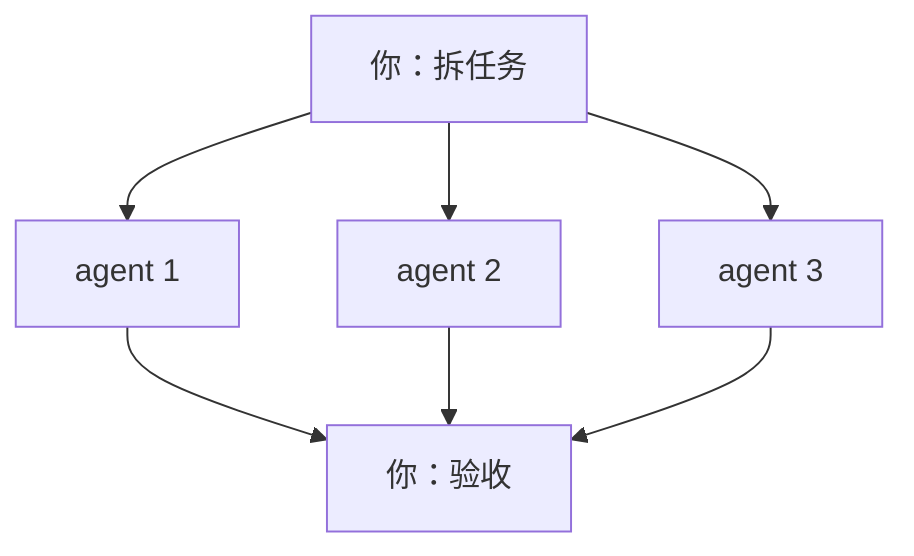

## Q
**管理一组 agents 像带小团队**｜实践 · 追问

你同时让五个 agent 做五件事。怎么避免像一个没带过人的新 manager 一样乱？

## A
| 带人 | 带 agent |
|---|---|
| **任务切分** | 按文件或模块边界切，避免两个 agent 改同一处（t02 worktree） |
| **上下文交接** | 写下来：spec、context file、progress file；别指望"它记得" |
| **验收** | 每个任务有可运行的 check；先看证据（命令和输出）再看总结 |
| **委派粒度** | 太细你成了瓶颈，太粗它跑偏。以"一个提交、一个 spec"为单位 |
| **汇报** | 要求 OK / FAIL 加原因，而不是长篇叙述 |

**限制：** 你的验收带宽是上限。五个 agent 同时交活，你只有一个人读 diff——所以并行数量由你的审查能力决定，不是由机器决定。

**出处：** Claude Code docs《Best practices》（Run sessions in parallel；Let Claude run without you）
