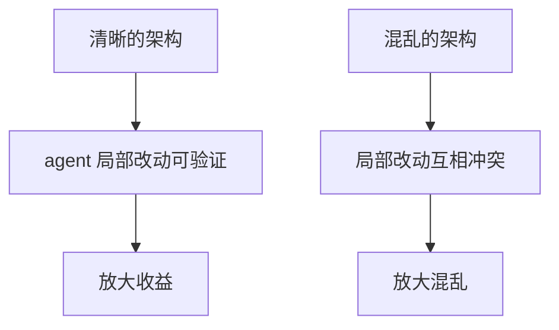

## Q
**Architecture 与 judgment 的价值上升**｜摘要 · 必会

agent 能在每个任务里写出局部正确的代码。为什么系统级的一致性反而更依赖人？

## A
**agent 放大的是局部产出。** 它在一个 session 的 context 里工作，看不到团队没写进仓库的决定、跨服务的假设、长期的演化方向（t01：不擅长隐含约束和跨系统一致性）。

| agent 做得到 | 仍靠人 |
|---|---|
| 在一个模块里实现需求 | 模块边界划在哪、依赖方向 |
| 按已有模式新增一个接口 | 要不要引入新模式；哪些旧模式要淘汰 |
| 改完让局部测试通过 | 多个服务的一致性、数据迁移的顺序、回滚方案 |

**DORA 2025 的另一面：** AI 放大已有的强项和弱点。架构边界清楚的系统，agent 的改动更容易被验证；边界乱的系统，agent 会更快地制造更乱的东西。

**杠杆在评审和决策：** 你对一个架构决定的一次判断，会被多个 agent、几十个任务反复使用；错一次的代价同样被放大。

**出处：** DORA《2025 State of AI-assisted Software Development》（amplifier）；Claude Code docs《Best practices》（Tell Claude what it can't see）
