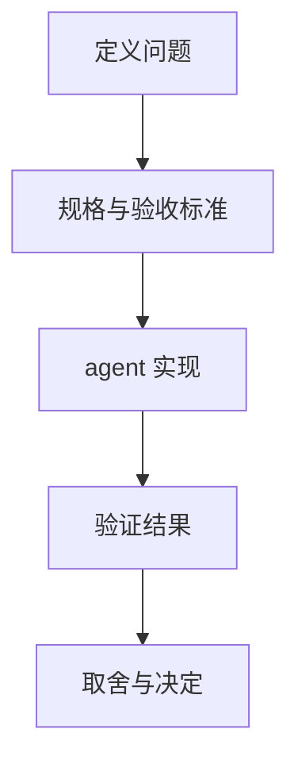

## Q
**从写代码到定义问题与验证结果**｜摘要 · 必会

agent 能写大部分实现代码以后，资深工程师的产出变成了什么？

## A
**产出前移和后移：** 实现这一段被 agent 承担，人的工作集中在两头。

| 前端：定义 | 后端：验证 |
|---|---|
| 把含糊需求变成 spec：目标、验收标准、边界、范围外 | 设计 check：测试、e2e、基准 |
| 画出架构边界：agent 在哪个模块里做事、不许碰什么 | 对照 spec 审查；小 diff 逐段读 |
| 判断哪些任务适合交出去 | 对结果负责：合并、上线 |

**为什么说规格就是评测：** 同一份 spec 既告诉 agent 做什么，又是审查的标尺（t02、t04）。写不清 spec 的人，无法评判输出。

**官方的分工描述（2026-11）：** 无人值守时，留给你的是启动任务、决定"完成"这一次意味着什么、批准最后的合并。

**别做：** 把"提示词写得好"当成新的核心技能；核心是**问题定义和验证**，提示只是其中一环。

出处

Claude Code docs《Best practices》（Let Claude run without you：The parts that stay with you）

