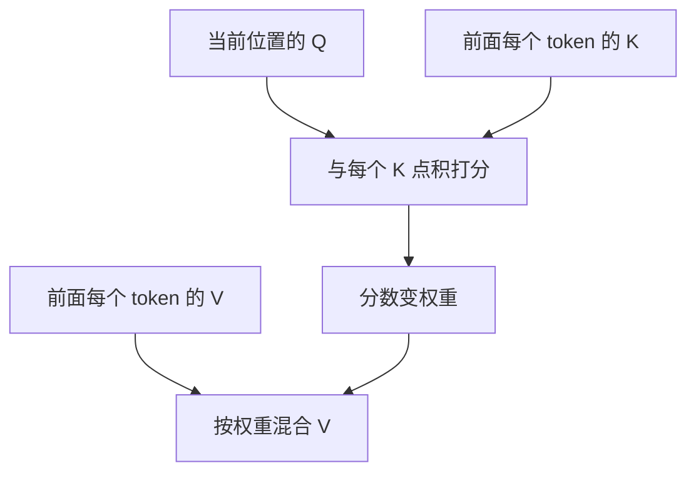

## Q
**Attention · 直觉**｜先修 · 必会

模型要预测"The cat sat on the ___"的下一个词，它怎么决定前面哪些 token 重要？transformer 里的 attention 在做什么，用什么比喻最容易记？

## A
**一句话：** 生成每一个新 token 时，模型都会给**前面每个 token 打一个相关度分数**，按分数把它们的信息加权混在一起，再据此预测。

**Transformer** 是今天大多数 LLM 使用的网络结构，核心就是 attention。每个前面的 token 会得到两个向量（vector，一串数字），用查资料的过程来比喻：

| 名字 | 谁的 | 比喻 |
|---|---|---|
| Query（Q） | 当前要预测的位置 | 正在找信息的人 |
| Key（K） | 前面每个 token | 每页资料的页码（用来被查找） |
| Value（V） | 前面每个 token | 每页的内容 |

- Q 和每个 K 做点积（dot product），分数高 = 这个 token 相关 = 更多使用它的 V。
- 前面的 token 包括你输入的，也包括模型已经生成出来的。
- 几乎总是 **multi-head**：把向量分成许多小份，每份（一个 head）各自关注不同的前文。例如 Llama 2-7B 的向量维度是 4,096，有 32 个 head，每个 head 128 维（4096 ÷ 32）。

出处

Huyen《AI Engineering》ch2 §Transformer architecture → Attention mechanism

