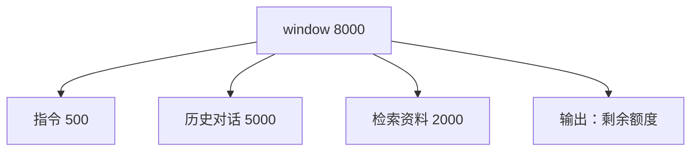

## Q
**Context window · 里面装什么**｜先修 · 必会

文档说某个模型的 context window 是 8,000 token。你的应用有这些内容：指令 500 token、对话历史 5,000 token、检索到的资料 2,000 token。用户还要模型写一段回答。最多还能写多长？如果资料再多 1,000 token 会怎样？

## A
**一句话：** context window（也叫 context length）是一次调用里模型能看到的 token 总量上限。**输入和输出共用**这一个额度。

**算：** 8,000 − 500 − 5,000 − 2,000 = **500 token**，只够约 375 个英文单词（按 ¾ 词/token）。再多 1,000 token 资料，输入就超过额度，只能删减历史、压缩资料或换更长窗口的模型。

**要点：**
- 模型本身不会"记住"上一轮对话。多轮对话要靠应用把前面的消息**再放进这次的输入**，所以历史越长，占的窗口越多（模型的 context 是它的 short-term memory，调用结束就没了）。
- 窗口的上限是模型的属性：GPT 前三代是 1K、2K、4K；到 2024 年 5 月 Gemini-1.5 Pro 公布 2M，五年里增长约 2,000 倍。100K 能装下一本中等篇幅的书。

**出处：** Huyen《AI Engineering》ch5 §Context Length and Context Efficiency；ch6 §Memory（短期记忆）
