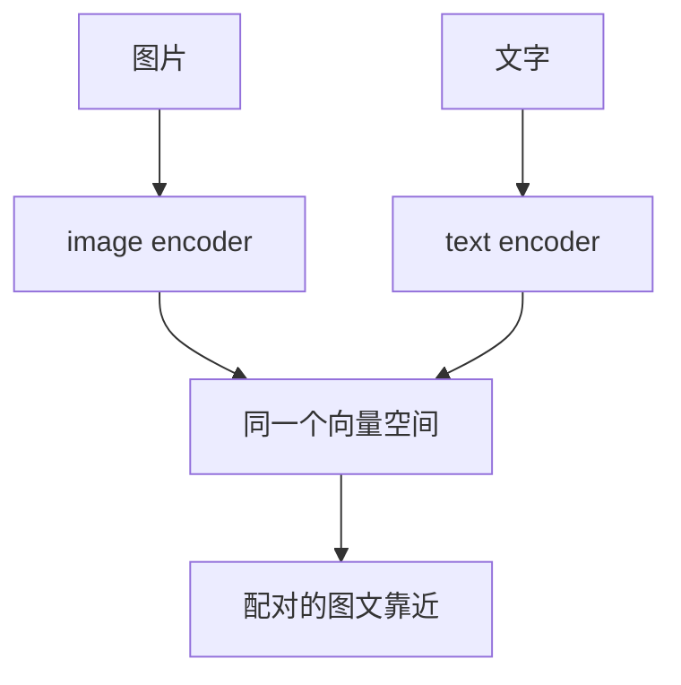

## Q
**Embedding · 怎么验证它"有意思"，以及图文共用一个空间**｜先修 · 追问

两个 embedding 模型，哪个更好？怎么在不看数字含义的前提下判断？CLIP 把图片和文字放进同一个空间，能做出什么功能？

## A
**两种验证：**

| 方法 | 做法 |
|---|---|
| 看距离 | 选一批你知道相似/不相似的文本对，相似的向量是不是更近 |
| 看任务效果 | 在你的任务（分类、推荐，或 RAG：先检索资料再回答，第 3 部分细讲）上直接比；通用基准如 MTEB（Massive Text Embedding Benchmark）覆盖多个任务 |

**多模态（multimodal）embedding：** CLIP 用（图片, 对应文字）配对训练：图片过 image encoder 得向量，文字过 text encoder 得向量，两者投影到**同一个空间**，训练目标是让配对的图和文字靠近。

- 空间里"一个人钓鱼的照片"离文字"a fisherman"比离"fashion show"更近。
- 这就可以做**文字搜图片**：把查询文字变成向量，找离它最近的图片向量。

**出处：** Huyen《AI Engineering》ch3 §Introduction to Embedding（MTEB、CLIP、multimodal embedding space）
