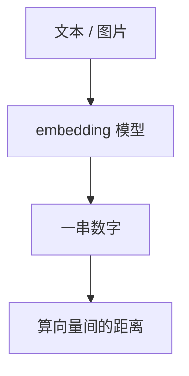

## Q
**Embedding · 是什么**｜先修 · 必会

"the cat sits on a mat"被一个 embedding 模型变成 `[0.11, 0.02, 0.54, …]` 这样一串数字。这串数字看起来和原文毫无关系，它有什么用？

## A
**一句话：** embedding 是一个**向量**（vector，一串数字），目的是用数字**表达原数据的意思**。意思越相近，向量就越近。

- 向量的长度（维度）通常在 100 到 10,000 之间；上面写 3 个数只是示意。
- 计算机只能处理数字，模型必须先把输入变成数字再处理。

| 模型（ch3 Table 3-2） | 向量长度 |
|---|---|
| BERT base / large | 768 / 1,024 |
| OpenAI text-embedding-3-small / large | 1,536 / 3,072 |
| Cohere embed-english-v3.0 / light-3.0 | 1,024 / 384 |

**怎么判断好坏：** "近"用 **cosine similarity**（比较两个向量方向有多接近）这类指标衡量。"the cat sits on a mat" 的向量，应该比 "AI research is super fun" 更接近 "the dog plays on the grass"。

**用途：** 分类、推荐、语义检索，以及 RAG（先按意思找出相关资料再交给模型）都靠 embedding。任何数据都可以有 embedding：商品、图片、用户。

出处

Huyen《AI Engineering》ch3 §Introduction to Embedding（Table 3-2）

