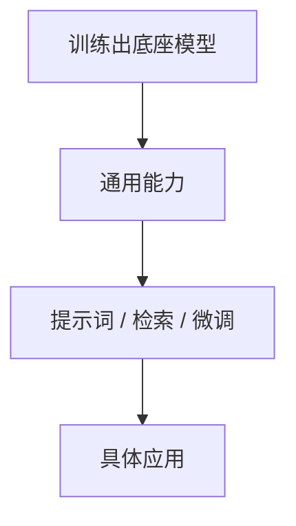

## Q
**Foundation model · 和 LLM 有什么区别**｜先修 · 必会

文档里时而说 LLM，时而说 foundation model。两者差在哪里？这个词为什么对做应用的人重要？

## A
**一句话：** **foundation model** 是能处理文本、图像、视频等多种数据的大模型，可以在它之上做各种应用。LLM 只处理文本。

| 词 | 含义 |
|---|---|
| LLM | 只读写文本的大语言模型 |
| multimodal model | 能处理一种以上数据类型（modality）的模型 |
| foundation model | 通用的底座模型，常是 multimodal；「foundation」指应用都建在它上面 |

- multimodal 模型生成下一个 token 时，条件是文本 token 加图像 token（或它支持的其他类型）。
- 过去 AI 研究按数据类型分家：文本归 NLP，图像归计算机视觉，语音归语音识别与合成。foundation model 让一个模型通吃多种任务。

**对应用工程的意义：** 做应用的人不再自己训练模型，而是**用现成的**。这就是 **AI engineering**（在现有 foundation model 上构建应用）和传统 ML engineering（自己开发模型）的分界。

**出处：** Huyen《AI Engineering》ch1 §From Large Language Models to Foundation Models；§From Foundation Models to AI Engineering
